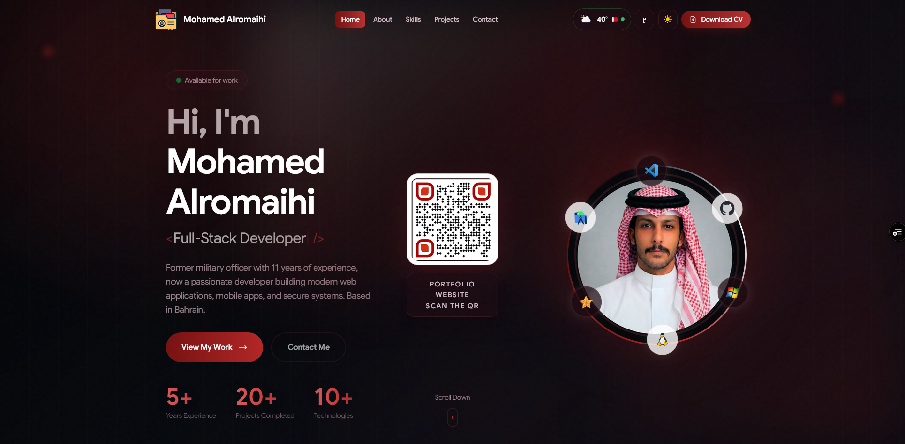

# Portfolio Website - Mohamed Saud Alromaihi

<div align="center">
  
</div>

<div align="center">
  
[](https://nextjs.org/)
[](https://www.typescriptlang.org/)
[](https://reactjs.org/)
[](https://tailwindcss.com/)
[](https://www.framer.com/motion/)

</div>

## 🚀 About

A modern, responsive portfolio website showcasing my journey as a **Full-Stack Developer**. Built with cutting-edge technologies and featuring stunning animations, interactive 3D elements, and a bilingual interface (English & Arabic).

## ✨ Key Features

- 🎨 **Modern Design**: Premium glassmorphism effects, gradient backgrounds, and smooth animations
- 🌐 **Bilingual Support**: Full RTL support for Arabic and English languages
- 📱 **Fully Responsive**: Optimized for all devices from mobile to desktop
- ⚡ **Performance Optimized**: Built with Next.js 15 for lightning-fast loading
- 🎭 **Interactive 3D Elements**: 
  - Rotating tech icons around profile picture
  - Interactive 3D Icon Cloud with Fibonacci sphere distribution
  - Smooth drag and auto-rotation effects
- 🌙 **Dark Mode**: Eye-friendly dark theme throughout
- 📊 **Dynamic Sections**:
  - Hero with typing animation
  - Animated timeline journey
  - Skills showcase with category filters
  - Project gallery
  - Contact form with email integration
- 🎬 **Premium Animations**: Using Framer Motion for fluid transitions
- 🔥 **Preloader**: Engaging tech stack showcase with developer facts

## 🛠️ Tech Stack

### **Frontend**
- **Framework**: Next.js 15.1.6 (React 19)
- **Language**: TypeScript 5
- **Styling**: Tailwind CSS 3.4
- **Animations**: Framer Motion 11.18
- **Icons**: Lucide React

### **Build Tools**
- **Package Manager**: pnpm
- **Development**: Next.js Development Server
- **Production**: Vercel (Recommended)

### **Key Libraries**
- `next-intl`: Internationalization (i18n) for bilingual support
- `framer-motion`: Advanced animations and transitions
- `lucide-react`: Modern icon library
- Custom 3D Icon Cloud component with canvas rendering

## 📦 Installation

1. **Clone the repository**
```bash
git clone https://github.com/Msr7799/my-portfolio.git
cd my-portfolio
```

2. **Install dependencies**
```bash
pnpm install
```

3. **Run the development server**
```bash
pnpm dev
```

4. **Open your browser**
```
http://localhost:3000
```

## 🏗️ Build & Deployment

### **Development Build**
```bash
pnpm dev
```

### **Production Build**
```bash
pnpm build
pnpm start
```

### **Deploy to Vercel**
[](https://vercel.com/new/clone?repository-url=https://github.com/Msr7799/my-portfolio)

The easiest way to deploy is using [Vercel](https://vercel.com):
1. Push your code to GitHub
2. Import the project to Vercel
3. Vercel will auto-detect Next.js and deploy

## 📂 Project Structure

```
my-portfolio/
├── public/
│   ├── assets/
│   │   ├── tech/          # Technology icons
│   │   ├── My-pics/       # Profile images
│   │   └── projects/      # Project images
│   └── locales/           # i18n translations (ar, en)
├── src/
│   ├── app/               # Next.js App Router
│   ├── components/        # React components
│   │   ├── ui/           # Reusable UI components
│   │   ├── HeroSection.tsx
│   │   ├── About.tsx
│   │   ├── SkillsSection.tsx
│   │   ├── ProjectsSection.tsx
│   │   ├── TimelineSection.tsx
│   │   ├── ContactSection.tsx
│   │   ├── Footer.tsx
│   │   ├── Header.tsx
│   │   └── Preloader.tsx
│   ├── context/          # React Context (App, Language)
│   └── styles/           # Global CSS
├── i18n.ts              # Internationalization config
└── tailwind.config.ts   # Tailwind configuration
```

## 🌍 Internationalization (i18n)

The website supports both English and Arabic with full RTL support:

- **English**: `/en`
- **Arabic**: `/ar`

Language files are located in `public/locales/`.

## 🎨 Customization

### **Colors**
Edit the CSS variables in `src/app/globals.css`:
```css
:root {
  --background: #0a0a0f;
  --foreground: #ffffff;
  --primary: #667eea;
  /* ... more colors */
}
```

### **Tech Stack Icons**
Add your icons to `public/assets/tech/` and update the arrays in:
- `src/components/HeroSection.tsx` - Floating tech images
- `src/components/SkillsSection.tsx` - Skills section
- `src/components/Preloader.tsx` - Preloader icons

## 📸 Screenshots

> **Note**: Add your portfolio screenshots to `public/assets/` and replace the image path in this README.

## 📝 License

This project is open source and available under the [MIT License](LICENSE).

## 👨‍💻 Developer

**Mohamed Alromaihi**
- 🔗 [Portfolio](https://your-portfolio-url.com)
- 💼 [LinkedIn](https://linkedin.com/in/your-profile)
- 🐙 [GitHub](https://github.com/Msr7799)
- 📧 [Email](mailto:your-email@example.com)

---

<div align="center">
  <p>Made with ❤️ and ☕ by Mohamed Alromaihi</p>
  <p>⭐ Star this repo if you like it!</p>
</div>
